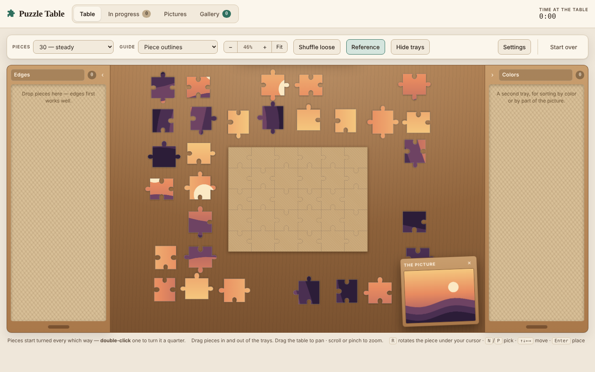
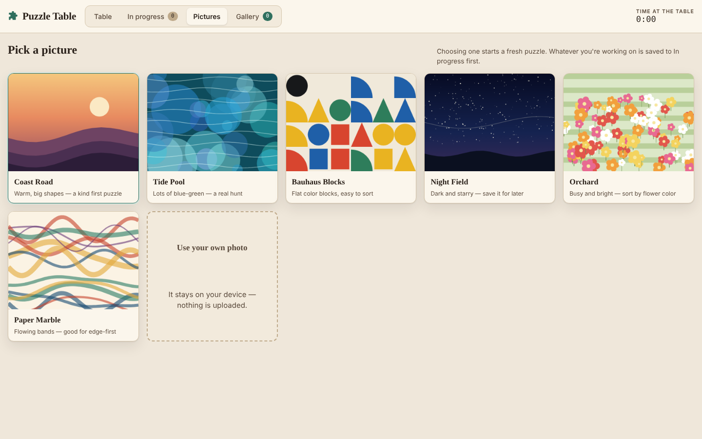

# 🧩 Puzzle Table

**A jigsaw puzzle that lives in your browser. One HTML file, no libraries, nothing to install.**

[Developer guide](docs/DEVELOPMENT.md) · Built by Navya Gupta, vibe-coded with Claude



## The idea

Most online jigsaws feel like a toolbar with a puzzle stuck in the middle. Puzzle Table is built around the physical object instead: a wooden table, drawers you sort pieces into, and the box lid propped up beside you. Starting a new puzzle never throws the old one away, and finished puzzles get framed and hung in a gallery.

## What it does

| Tab | What you do there |
|---|---|
| **Table** | Solve the puzzle. Zoom and pan the whole table, sort pieces into two named trays, and keep the reference picture propped up beside the board. |
| **In progress** | Every puzzle you've started, saved exactly as you left it, with a thumbnail, how much is placed, and when you last played. |
| **Pictures** | Choose a picture to start a fresh puzzle, or upload your own. |
| **Gallery** | Finished puzzles, titled by you, framed, and hung on a gallery wall grouped by month. |



## How it was built

1. **Started simple:** a board, loose pieces and snapping.
2. **Listened to feedback:** each round of notes removed things (a progress bar, a difficulty select, a cut-style picker) and added structure (trays, tabs, saves, the gallery).
3. **Kept it calm:** one job per screen, friendly copy, and a celebration that never covers the finished picture.

## Technical highlights

- **Piece shapes:** every piece is cut with Bézier curves, and neighbours share the same edge, so tabs always fit their slots.
- **Joining pieces:** a union-find structure tracks which pieces are connected, so groups move together and merge as you snap them.
- **Resume anywhere:** progress autosaves to the browser (up to 8 puzzles) and restores from stored geometry, so pieces land exactly where you left them.
- **Hit-testing:** grabbing a piece checks the actual pixels under the pointer, accounting for zoom and rotation, so you can't grab a piece by its empty corner.
- **Pictures drawn in code:** six generated artworks, so there are no image files to load or license.
- **Accessible by default:** keyboard play (N/P to pick, arrows to move, Enter to place), visible focus, reduced-motion support, light and dark themes.
- **Stack:** plain HTML, CSS and JavaScript. No build step, no dependencies.

```
index.html
├── picture library   six artworks drawn on a canvas
├── geometry          piece paths, board backing, scatter
├── snapping          union-find groups, tolerance snap
├── input             drag, pan, pinch, tray drops
├── saves + gallery   localStorage, frames, month grouping
└── self-check        runs on load, logs if anything is off
```

## Run it yourself

```bash
git clone https://github.com/navyagup014/Puzzle-Table.git
cd Puzzle-Table
open index.html   # or just double-click the file
```

Everything you make is stored in your browser's local storage, so nothing leaves your machine.

## About

A browser jigsaw with trays, saves and a gallery. Built as a personal project.
